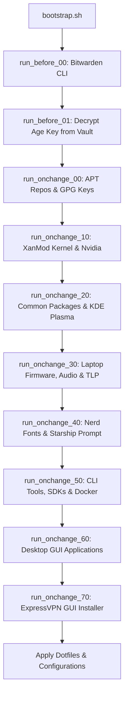

# Yury Smirnov's Dotfiles

Personal Linux development environment and dotfiles repository for Debian-based systems (optimized for Debian Trixie/Testing with KDE Plasma desktop), managed using [chezmoi](https://www.chezmoi.io/) and secured with [Age](https://github.com/FiloSottile/age) & [Bitwarden](https://bitwarden.com/).

---

## 📋 Overview

This repository automates the end-to-end setup of a full-featured Linux workstation or laptop. It provisions hardware-specific drivers, kernel enhancements, developer runtimes, desktop applications, theme customizations, and shell tools.

### 🌟 Key Features

* **⚡ One-Command Bootstrap**: Complete system initialization via `bootstrap.sh` with automated Bitwarden integration for secrets retrieval.
* **🔐 Age & Bitwarden Security**: Identity keys and sensitive SSH configuration are encrypted via Age; the secret key is securely stored in Bitwarden Vault.
* **💻 Dynamic Hardware Detection (`.chezmoi.yaml.tmpl`)**:
  * **Laptop Detection**: Automatically installs power management (`tlp`, `thermald`, `powertop`), firmware (`firmware-iwlwifi`), Bluetooth (`bluedevil`), and PipeWire/WirePlumber audio stack.
  * **Nvidia GPU Detection**: Installs proprietary Nvidia drivers (`nvidia-driver-580`, `nvidia-vaapi-driver`), disables `ibt=off` in GRUB, and re-generates kernel configurations.
* **🐧 XanMod Kernel**: Installs the high-performance `linux-xanmod-lts-x64v3` kernel along with necessary compilation tooling.
* **🛠️ Developer Infrastructure & Runtimes**:
  * **SDKMAN!**: Java (Temurin 25.0.4) & Maven (3.9.16).
  * **Node.js & npm**: System runtimes installed from Debian repository.
  * **SQLite**: SQLite 3 database CLI tooling and DB Browser for SQLite (`sqlitebrowser`) from Debian repository.
  * **Google Antigravity CLI**: `agy` executable provisioning, terminal sandbox enforcement, curated safe command allowlist, and GitHub MCP integration with zero-plaintext Age-encrypted secrets (`mcp-env-exec` / `mcp-secrets-edit`).
  * **Docker Engine**: Official upstream Docker repository setup, user group auto-assignment, and `docker-compose-plugin` / `docker-buildx-plugin`.
* **🎨 Desktop Environment & Themes**:
  * **KDE Plasma**: Minimal KDE Plasma desktop environment (`kde-plasma-desktop`) with SDDM, Xorg fallback, System Settings, KScreen, PowerDevil, Spectacle, System Monitor, Ark, Gwenview, Plasma Network/Audio applets (`pipewire-audio`), `kio-extras`/`kio-fuse`, and `xdg-desktop-portal-kde`/`gtk`, configured with **Breeze Light** look-and-feel, keyboard layouts (US + RU with `Alt+Shift` toggle), and Dolphin global view preferences.
  * **Themes, Icons & Cursor**: Breeze GTK theme (`breeze-gtk-theme`, `kde-config-gtk-style`, `xsettingsd`, `sddm-theme-breeze`, `sddm-theme-debian-breeze`, `desktop-base`, `grub-theme-breeze`), Papirus Light icon set, Bibata Modern Ice cursor.
  * **Fonts & Prompt**: JetBrains Mono Nerd Font paired with [Starship](https://starship.rs/) prompt.
* **📦 Curated Software Suite**:
  * **Browsers**: Chromium, Firefox ESR, system web tools.
  * **IDEs & Editors**: IntelliJ IDEA Ultimate, Textadept, WezTerm.
  * **Communication & Utilities**: Telegram Desktop, Discord, Zoom, Filen Desktop, ExpressVPN, KTorrent, Okular, Strawberry, Haruna.
  * **Printing & Scanning**: CUPS (`cups`, `cups-browsed`), Avahi mDNS (`avahi-daemon`, `libnss-mdns`), KDE Print Manager (`print-manager`), Brother laser driver (`printer-driver-brlaser`), SANE AirScan (`sane-utils`, `sane-airscan`), and Skanpage (`skanpage`) for Wi-Fi printing and scanning.

---

## 📁 Repository Structure

```
.
├── .chezmoi.yaml.tmpl                     # Chezmoi configuration template (hardware probing)
├── AGENTS.md                              # Repository guidelines & operational rules
├── bootstrap.sh                            # Primary bootstrap entrypoint
├── README.md                              # Repository documentation
├── run_before_00-install-bitwarden-cli.sh # Ensures Bitwarden CLI (bw) is installed
├── run_before_01-decrypt-key.sh.tmpl      # Fetches Age private key from Bitwarden
├── run_onchange_00-add-repositories.sh    # Configures APT repos (XanMod, WezTerm, Docker, non-free)
├── run_onchange_10-install-xanmod.sh.tmpl # Installs XanMod kernel & Nvidia drivers (if present)
├── run_onchange_20-install-common-packages.sh      # Installs common CLI tools, KDE Plasma & themes
├── run_onchange_30-install-laptop-packages.sh.tmpl # Configures laptop power & audio (if laptop)
├── run_onchange_40-install-nerd-fonts.sh  # JetBrains Mono Nerd Font & Starship prompt
├── run_onchange_50-install-antigravity.sh # Google Antigravity CLI installer
├── run_onchange_50-install-docker.sh      # Docker Engine & plugin setup
├── run_onchange_50-install-git.sh         # Global git config & bash completion
├── run_onchange_50-install-sdks.sh        # SDKMAN!, Java 25, Maven installation
├── run_onchange_60-install-discord.sh     # Discord .deb installer
├── run_onchange_60-install-filen.sh       # Filen desktop client installer
├── run_onchange_60-install-intellij.sh    # IntelliJ IDEA Ultimate installer (/opt/idea)
├── run_onchange_60-install-telegram.sh    # Telegram Desktop installer (/opt/Telegram)
├── run_onchange_60-install-textadept.sh   # Textadept text editor installer (/opt/textadept)
├── run_onchange_60-install-zoom.sh        # Zoom .deb installer
├── run_onchange_70-install-expressvpn.sh  # ExpressVPN installer (requires active GUI session)
├── dot_bashrc.tmpl                        # Bash configuration template (~/.bashrc)
├── dot_wezterm.lua                        # WezTerm configuration (~/.wezterm.lua)
├── dot_textadept/
│   └── init.lua                           # Textadept configuration (~/.textadept/init.lua)
├── dot_config/
│   ├── agy/
│   │   └── private_mcp_secrets.env.age    # Age-encrypted MCP tokens kept encrypted on disk (~/.config/agy/mcp_secrets.env.age)
│   ├── fontconfig/
│   │   └── fonts.conf                     # Fontconfig RGB subpixel & full hinting (~/.config/fontconfig/fonts.conf)
│   └── mpv/
│       └── mpv.conf                       # mpv hardware video decoding (~/.config/mpv/mpv.conf)
├── dot_gemini/
│   ├── antigravity-cli/
│   │   └── private_settings.json.tmpl     # Antigravity CLI sandbox & permissions (~/.gemini/antigravity-cli/settings.json)
│   └── config/
│       └── private_mcp_config.json.tmpl   # Global Antigravity MCP server config (~/.gemini/config/mcp_config.json)
├── dot_local/
│   ├── bin/
│   │   ├── executable_mcp-env-exec        # Decrypts MCP secrets into memory and execs MCP servers
│   │   └── executable_mcp-secrets-edit    # Helper CLI to view/edit/set Age-encrypted MCP secrets
│   └── share/applications/                # Custom Desktop Launchers (.desktop files)
│       ├── intellij.desktop
│       └── textadept.desktop
└── private_dot_ssh/                       # Encrypted SSH configuration and keys
    ├── config.tmpl
    ├── encrypted_private_id_ed25519.age   # Age-encrypted private SSH key
    └── id_ed25519.pub
```

---

## 🚀 Quick Start / Bootstrapping

To set up a fresh Linux machine, run the bootstrap command. The script authenticates with Bitwarden using your **Personal API Key** (bypassing 2FA/TOTP prompts) and unlocks your vault to restore Age keys and secrets.

> [!TIP]
> You can find your Personal API Key in the Bitwarden Web Vault under **Settings** → **Security** → **Keys** tab → **View API Key** (`client_id` and `client_secret`).

### Option A: Fully Automated / Headless (Recommended)

Export your credentials into the shell environment beforehand:

```bash
export BW_CLIENTID="user.xxxxxxxx-xxxx-xxxx-xxxx-xxxxxxxxxxxx"
export BW_CLIENTSECRET="xxxxxxxxxxxxxxxxxxxxxxxxxxxxxxxx"
export BW_PASSWORD="your-master-password"

wget -qO- https://raw.githubusercontent.com/yury-smirnov87/dotfiles/main/bootstrap.sh | bash
```

### Option B: Interactive Execution

Run the script directly; it will securely prompt for your Client ID, Client Secret, and Master Password via `/dev/tty`:

```bash
wget -qO- https://raw.githubusercontent.com/yury-smirnov87/dotfiles/main/bootstrap.sh | bash
# or if cloned locally:
./bootstrap.sh
```

### What `bootstrap.sh` Does:

1. Ensures baseline dependencies (`git`, `unzip`, `pciutils`) and `~/.local/bin` exist.
2. Installs `chezmoi` idempotently into `~/.local/bin` using `wget`.
3. Downloads and installs the **Bitwarden CLI** (`bw`).
4. Authenticates to Bitwarden using your **Personal API Key** (bypassing 2FA) and unlocks the vault, exporting `BW_SESSION` in the active shell.
5. Immediately unsets API secrets and master password from the shell environment.
6. Initializes chezmoi from `https://github.com/yury-smirnov87/dotfiles.git`.
7. Executes `chezmoi apply --force` to decrypt Age keys, run all provisioning scripts, and apply dotfiles.
8. Reconfigures the chezmoi git remote URL to SSH (`git@github.com:yury-smirnov87/dotfiles.git`) once SSH keys are restored.

---

## 🔄 Execution Lifecycle

Chezmoi runs lifecycle scripts in numerical order:



### Managed Applications & Runtimes Summary

| Category | Component / Tool | Details |
| :--- | :--- | :--- |
| **Desktop Environment** | KDE Plasma | Minimal Plasma setup (`kde-plasma-desktop`, SDDM, System Settings, KScreen, PowerDevil, Spectacle, System Monitor, Ark, Gwenview, Plasma NM/PA, PipeWire), Breeze Light theme, US/RU (`Alt+Shift`), Papirus Light icons, Bibata cursor |
| **Shell & Terminal** | Bash, WezTerm, Starship | Gruvbox Material theme, JetBrains Mono Nerd Font, WebGPU support |
| **System Kernel** | XanMod LTS x64v3 | Optional Nvidia drivers (v580) with `ibt=off` GRUB parameter |
| **Development** | Java, Maven, Node.js, npm, Git, SQLite, jq, Antigravity CLI | SDKMAN! (Java 25 Temurin, Maven 3.9.16), Node.js & npm (Debian APT), Git completion, SQLite3 CLI & DB Browser for SQLite, `jq`, `agy` with sandbox & GitHub MCP |
| **IDEs & Editors** | IntelliJ IDEA, Textadept | Clean desktop integration, `/opt` installations, custom keybindings |
| **Browsers** | Chromium, Firefox ESR | Debian repository packages |
| **Containers** | Docker Engine | `docker-ce`, `docker-compose-plugin`, auto group configuration |
| **Productivity / Media** | Discord, Telegram, Zoom, Filen, Strawberry, Haruna | Official `.deb` packages, Linux tarballs, & Debian APT (`strawberry`, `haruna`) |
| **Printing & Scanning** | CUPS, Avahi, SANE, Skanpage | Wi-Fi IPP/AirPrint & eSCL/AirScan (`cups`, `cups-browsed`, `avahi-daemon`, `libnss-mdns`, `print-manager`, `printer-driver-brlaser`, `sane-utils`, `sane-airscan`, `skanpage`) |
| **VPN & Security** | ExpressVPN, Bitwarden, Age | CLI vault access & encrypted SSH keys |

---

## 🔑 Encryption & Secrets

This repository uses **Age encryption** via chezmoi integration:

* **Recipient Key**: `age1n62t5ygs08dtll40g306jttrdnj7ztqcf5yx5cjhszz6dv0ftuasajjw49`
* **Identity File**: `~/.config/chezmoi/key.txt`
* **Encrypted Assets**:
  * Private SSH identity (`encrypted_private_id_ed25519.age` — decrypted by chezmoi to `~/.ssh/id_ed25519`).
  * Antigravity MCP tokens (`dot_config/agy/private_mcp_secrets.env.age` — kept **encrypted on disk** at `~/.config/agy/mcp_secrets.env.age` and decrypted only into child process memory by `~/.local/bin/mcp-env-exec`).

### Re-encrypting / Editing Encrypted Files

To view or edit chezmoi-managed encrypted files:

```bash
chezmoi edit ~/.ssh/id_ed25519
```

To add or update Antigravity MCP secrets (such as `GITHUB_PERSONAL_ACCESS_TOKEN` or `JIRA_API_TOKEN`) without writing plaintext to disk:

```bash
# Set a token non-interactively in memory (updates both chezmoi source and ~/.config/agy/mcp_secrets.env.age):
mcp-secrets-edit set GITHUB_PERSONAL_ACCESS_TOKEN ghp_your_token_here

# Or edit all MCP secrets interactively in RAM (/dev/shm):
mcp-secrets-edit

# List configured secret variable names (values hidden):
mcp-secrets-edit list
```

---

## 🛠️ Daily Workflow

Standard commands for maintaining your dotfiles with chezmoi:

```bash
# Check status of local files vs chezmoi source
chezmoi status

# View differences before applying
chezmoi diff

# Apply pending changes
chezmoi apply

# Edit a managed file
chezmoi edit ~/.bashrc

# Navigate to the chezmoi source directory
chezmoi cd

# Commit and push changes
git add .
git commit -m "Update configuration"
git push origin main
```

---

## 📄 License

Personal repository maintained by [Yury Smirnov](https://github.com/yury-smirnov87). Open for reference and reuse.